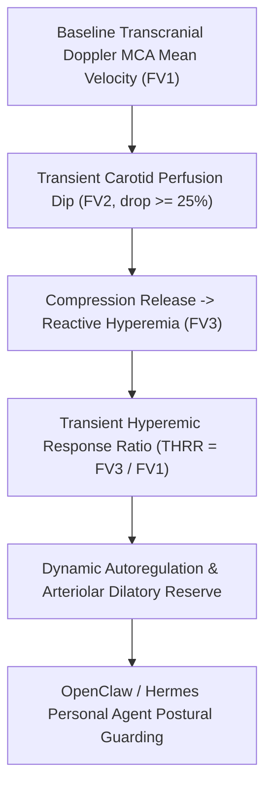

# Cerebral Autoregulation & Transient Hyperemic Response Ratio (THRR) Skill

[](LICENSE)
[](https://www.python.org/)
[](requirements.txt)
[](mcp_server.py)
[](SKILL.md)

Zero-dependency sovereign personal agent skill for non-invasive evaluation of Transcranial Doppler (TCD) Transient Hyperemic Response Ratio (THRR), carotid compression velocity drops, and cerebral dynamic autoregulatory reserve.



## Features
- **Deterministic Math**: Pure Python standard library implementation with zero external dependencies.
- **Neurovascular Standards**: Implements validated equations for TCD flow velocities, compression drop percentage, and Giller THRR ratios.
- **Dynamic Autoregulation Screening**: Detects early loss of myogenic and endothelial arteriolar vasodilatory capacity.
- **Model Context Protocol (MCP)**: Native JSON-RPC tool integration for LLMs and autonomous agents.

## Quickstart

```python
from client import CerebralAutoregulationTHRRClient

client = CerebralAutoregulationTHRRClient()
result = client.evaluate_thrr(
    baseline_flow_velocity_cm_s=62.0,
    compression_flow_velocity_cm_s=40.0,
    hyperemic_peak_flow_velocity_cm_s=78.5
)
print("THRR Ratio:", result["transient_hyperemic_response_ratio"])
print("Autoregulatory Score:", result["autoregulatory_reserve_score"])
print("Classification:", result["classification"])
```

## License
Apache-2.0
